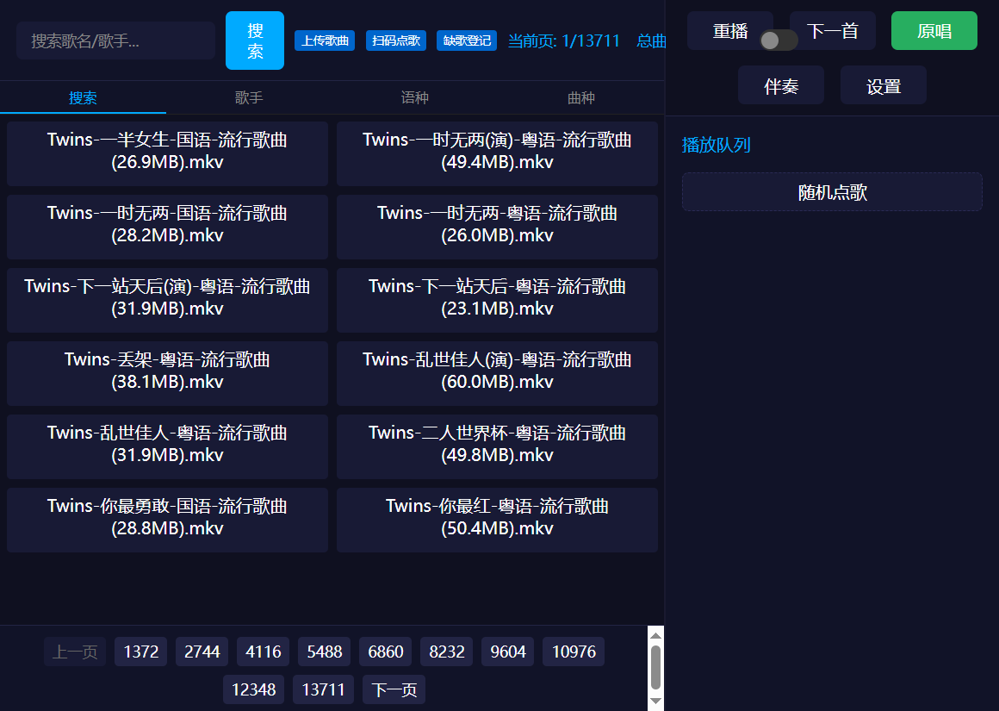
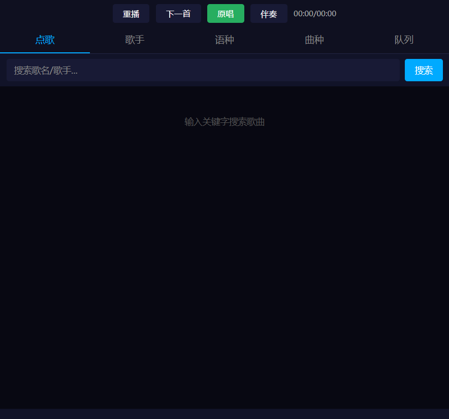
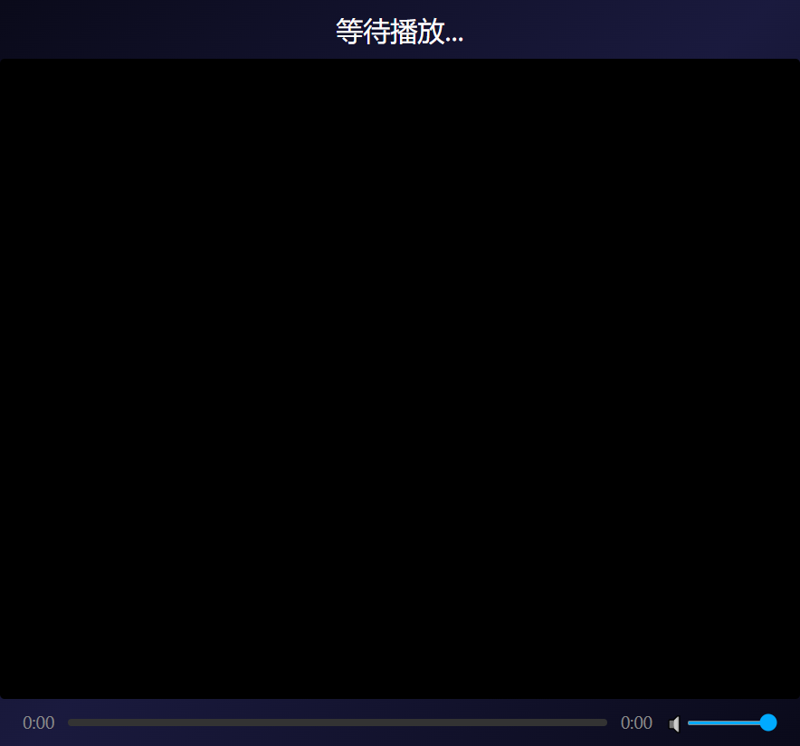

# Web KTV Server ／ 局域网 KTV 双屏点歌系统

[](https://go.dev)
[](https://www.microsoft.com/windows)
[](https://ffmpeg.org)
[](LICENSE)
[](.)

**一个用 Go + FFmpeg 编写的单文件局域网 KTV 双屏点歌系统（Karaoke Server）。** 约 10MB 的可执行文件，把你的 Windows 电脑变成一台 KTV 点歌机：16 万首曲库毫秒级拼音搜索、电视/投影双屏播放、手机扫码遥控、GPU 硬件转码、实时歌词滚动——无需数据库，无需安装客户端，局域网内开箱即用。

**A single-binary LAN KTV dual-screen karaoke server written in Go + FFmpeg.** ~10 MB executable, no database, no client install: millisecond pinyin search over a 160k-song library, dual-screen playback, QR-code phone remote, GPU-accelerated transcoding and real-time lyrics — turns any Windows PC into a KTV machine.

🌐 **语言 / Languages:** [简体中文](#简体中文) | [English](#english)

---

## 项目速览 / At a Glance

| | |
|---|---|
| **类型 / Type** | 局域网 KTV 点歌系统 / LAN KTV karaoke server |
| **语言 / Language** | Go 1.20（后端）+ 内嵌 HTML/JS（前端） |
| **平台 / Platform** | Windows 7 SP1 ~ Windows 11（32 位 + 64 位） |
| **部署 / Deploy** | 单文件 exe，免安装，免数据库 |
| **依赖 / Dependencies** | ffmpeg.exe + ffprobe.exe（放程序同目录） |
| **亮点 / Highlights** | 拼音搜索 · 双屏点歌 · 扫码遥控 · GPU 转码 · 实时歌词 · 边下边播 |
| **许可证 / License** | [MIT](LICENSE) |

---

## 目录 / Table of Contents

- [简体中文](#简体中文)
  - [功能特性](#功能特性)
  - [界面截图](#界面截图)
  - [快速开始](#快速开始)
  - [从源码编译](#从源码编译)
  - [配置说明](#配置说明)
  - [技术栈与架构](#技术栈与架构)
  - [常见问题](#常见问题)
- [English](#english)

---

## 简体中文

### 简介

Web KTV Server 是一个轻量级的**局域网 KTV 双屏点歌系统**：一台 Windows 主机 +  ffmpeg 即可运行，电视/投影仪作为播放屏，任意设备的浏览器作为点歌屏，手机扫码即可遥控。适合家庭 KTV、练歌房、量贩式 KTV 包间、公司活动等场景。

核心能力：**10 毫秒级拼音搜索**（16 万首曲库）、**原唱/伴奏一键切换**、**实时滚动歌词**、**GPU 硬件转码**（NVENC/QSV/AMF）、**手机扫码点歌**、**待播歌曲下载到本机**。

### 功能特性

#### 🔍 点歌方式
- 关键词搜索，16 万首曲库 10 毫秒出结果
- 歌名 + 歌手组合搜索，拼音首字母搜索（如输入 "zjl" 找到周杰伦）
- 歌手分类浏览，按首字母快速定位
- 语种分类（国语/粤语/英语/日语/韩语…）、曲种分类（流行/经典老歌/摇滚/民谣…）
- 随机点歌，同名歌曲自动标注文件大小
- Everything 文件扩充搜索：自动读取 HTTP 端口/账号，支持本机全盘搜索直接点播
- 缺歌登记：自动记录搜不到的关键词，方便补曲库

#### ▶️ 播放
- 视频/音频自动识别，**原唱/伴奏一键切换**（多音轨文件自动列出音轨）
- 内嵌歌词实时滚动，支持在线歌词搜索 / 手动匹配 / 偏移微调
- 音频可视化：歌词 / 波形 / 频谱条 / 频谱曲线四种模式
- 曲库文件异常自动检测（无画面/无声音文件红色标注）
- **隔行(1080i) H.264 自动检测并去隔行转码**，彻底解决浏览器播放卡死
- **边写边播**：无可用曲目且队首进入转码时，实时流式播放分片 MP4，无需等待转码完成
- 自适应音量 · 前瞻限幅，自动平衡响度并压住瞬态破音
- HEVC/H.265、WMA/APE/DSD(DST) 等自动转码 / 实时推流

#### 📱 手机遥控
- 扫码即用，无需安装 APP
- 搜索、点歌、切歌、重唱、音量、快进 10 秒……
- 可设密码，多人同时扫码队列共享

#### 📥 下载已点歌曲（v1.14 新增）
- 播放队列一键下载到本机，三种方式可选：
  1. **原文件下载**——原样带走，多音轨也是一个文件
  2. **仅下载音频数据流**——从曲库文件抽出音频流，按编码生成合适后缀（.aac/.flac/.opus/.ogg/.ac3/.dts/.wma/.m4a/.wav…）
  3. **下载为 MP3**——统一转码 256kbps（源已是 MP3 则直接拷贝，不二次有损）
- 多音轨文件自动拆分为 `原文件名(音轨1)`、`原文件名(音轨2)` 等多个文件
- 下载产物本地缓存（24 小时自动清理），重复下载秒出

#### ⚡ 性能与稳定性（v1.14 改进）
- **ffprobe 探测串行化**：曲库在移动机械硬盘/USB 硬盘时，并发探测不再争抢磁头，批量点歌不再卡顿
- **磁盘休眠看门狗**：外置硬盘休眠唤醒的耗时在控制台实时可见，慢探测自动记录

#### 💡 省流模式
- 一键开启，视频实时转码低码率传输
- GPU 全流水线加速（解码 + 编码都在 GPU），1-2 秒出画面
- 动态流控，只缓冲 15 秒，切歌不浪费带宽

#### 🛠 系统自检与管理
- 启动时自动检测 FFmpeg、FFprobe、GPU 加速、曲库目录
- 打开页面即显示系统状态总览，异常红色标注附解决方案
- 网页拖拽上传歌曲，上传后自动增量扫描，含内容审核（待审核文件自动标注并引导审核）
- 曲库缓存：二次启动秒级加载；热歌榜自动统计
- NVIDIA / AMD / Intel GPU 自动检测，无 GPU 自动回退 CPU 编码

### 界面截图

<table>
<tr>
<td></td>
<td></td>
</tr>
<tr>
<td></td>
<td></td>
</tr>
</table>

### 快速开始

**1. 下载程序** — 从 [Releases](https://github.com/ehfeo/Web-ktv-server/releases) 下载最新版本（`ktv.exe` 64 位 / `ktv-32bit.exe` 32 位）。

**2. 准备 FFmpeg** — 下载 [ffmpeg.exe](https://www.gyan.dev/ffmpeg/builds/) 和 [ffprobe.exe](https://www.gyan.dev/ffmpeg/builds/)，放到程序同目录。

> 需要 GPU 加速转码，请使用完整版 FFmpeg（含 NVENC/QSV/AMF 支持）。

**3. 运行** — 双击 exe，在菜单里选 `1` 启动服务器。

**4. 使用**
1. 首次启动按提示填入歌曲目录（支持多个盘符，如 `D:\CloudMusic`、`H:\MTV`）
2. 电视/投影仪浏览器打开控制台显示的地址 → 播放屏
3. 其他设备浏览器打开同一地址 → 点歌屏；手机扫二维码 → 遥控器

### 从源码编译

需要 Go 1.20.14（确保 Win7 SP1 兼容性）：

```powershell
# 一键编译 32 位和 64 位版本（输出到 dist/）
.\build.ps1
```

或手动编译：

```powershell
# 64 位
go build -o ktv.exe .

# 32 位（兼容老机器）
$env:GOARCH="386"; go build -o ktv-32bit.exe .
```

### 配置说明

首次运行后在菜单中设置，配置保存在程序目录的 `ktv_config.json`：

| 配置项 | 说明 |
|---|---|
| `mediaDirs` | 曲库目录，支持多个（数组） |
| `port` | 服务端口，默认 `8351` |
| `audioTranscodeBitrate` | 音频实时转码码率（32-512 kbps） |
| `everythingEnabled` / `everythingPath` / `everythingPort` | Everything 全盘扩充搜索 |

### 技术栈与架构

- **Go 1.20** 单体 HTTP 服务，前端全部 `go:embed` 内嵌，单文件部署
- **FFmpeg 管道**：Fragmented MP4 实时流媒体输出，边转码边播放
- **GPU 全流水线**：CUDA 解码 + NVENC 编码（QSV/AMF 同样支持），无 GPU 自动回退 CPU
- **Web Audio API** 实时可视化，预分配缓冲零 GC
- **QR 中继架构**：内置/外接两种二维码服务器模式，支持跨网段扫码点歌
- **曲库索引**：缓存 + 增量扫描 + 预计算搜索索引（拼音首字母），16 万首 10ms 出结果
- **探测串行化**：ffprobe 全局互斥锁，机械硬盘曲库下避免磁头争抢

### 常见问题

**Q: 首次扫描曲库要多久？**
A: 16 万首约几分钟，仅一次；之后走缓存秒级启动。曲库在 USB 移动硬盘上时，休眠盘的首次访问会慢几秒，属正常现象（控制台有耗时日志）。

**Q: 没有独立显卡能跑吗？**
A: 可以。自动检测 GPU，无 NVIDIA/AMD/Intel 独显时回退 CPU 编码（libx264），画面略灰但功能完整。

**Q: 手机必须和电脑同一网段吗？**
A: 点歌与遥控需要在同一局域网；外接二维码服务器模式可支持跨网段。

**Q: 支持哪些音视频格式？**
A: 浏览器能直接播的（H.264 MP4 等）直接播；不兼容的（HEVC/H.265、RMVB、WMV、APE、DSD、DTS…）自动转码/实时推流。

**Q: 下载已点歌曲支持多音轨文件吗？**
A: 支持。选"仅音频流"或"MP3"时，多音轨文件会自动按 `原文件名(音轨1)`、`原文件名(音轨2)` 拆成多个文件下载。

---

## English

### Introduction

Web KTV Server is a lightweight **LAN KTV dual-screen karaoke server**: one Windows PC + FFmpeg, and your TV/projector becomes the playback screen while any browser becomes the remote. No database, no client install — download one ~10 MB exe and go. Ideal for home KTV, practice rooms, KTV booths and company events.

Core capabilities: **10 ms pinyin search** (160k songs), **one-click vocal/accompaniment switch**, **real-time scrolling lyrics**, **GPU-accelerated transcoding** (NVENC/QSV/AMF), **QR-code phone remote**, and **download queued songs to your device**.

### Features

#### 🔍 Song Selection
- Keyword search over a 160k-song library, results in ~10 ms
- Title + artist combined search; pinyin-initials search ("zjl" → Jay Chou)
- Artist browsing with A-Z quick navigation
- Language categories (Mandarin/Cantonese/English/Japanese/Korean…) and genre categories (Pop/Classics/Rock/Folk…)
- Random pick; duplicate titles auto-marked with file size
- Everything expanded search: reads HTTP port/credentials automatically, searches the whole drive and plays directly
- Missing-song registration for unsearchable keywords

#### ▶️ Playback
- Auto video/audio detection; **one-click vocal/accompaniment switch** (multi-track files list every audio track)
- Built-in real-time scrolling lyrics with online search / manual match / offset fine-tune
- Audio visualization: lyrics / waveform / spectral bars / spectral curve
- Auto-detect broken library files (red badges for no-video/no-audio)
- **Auto-detect and deinterlace interlaced (1080i) H.264** — fixes browser playback freezes for good
- **Play-while-transcoding**: fragmented MP4 streamed live when the queue front is still converting
- Adaptive volume with look-ahead limiting
- HEVC/H.265, RMVB, WMV, APE, DSD, DTS… auto-transcode / real-time streaming

#### 📱 Mobile Remote
- Scan QR to use — no app install
- Search, select, change song, replay, volume, seek +10s…
- Optional password; multi-device shared queue

#### 📥 Download Queued Songs (new in v1.14)
- One click to download the whole play queue, three modes:
  1. **Original files** — as-is, multi-track included in one file
  2. **Audio-only** — extract the audio stream, correct extension by codec (.aac/.flac/.opus/.ogg/.ac3/.dts/.wma/.m4a/.wav…)
  3. **MP3** — unified 256 kbps transcode (source MP3 is copied directly, no re-encode loss)
- Multi-track files split automatically into `name(音轨1)`, `name(音轨2)`, …
- Local product cache with 24 h auto-cleanup; repeat downloads are instant

#### ⚡ Performance & Stability (improved in v1.14)
- **Serialized ffprobe**: concurrent probes no longer fight over the disk head when the library lives on a mechanical/USB HDD — batch selection stays smooth
- **Disk-sleep watchdog**: spin-up costs on external drives are now logged with timing

#### 💡 Low-Bandwidth Mode
- One-click real-time low-bitrate transcoding
- Full GPU pipeline (decode + encode on GPU), picture in 1-2 s
- Dynamic flow control, buffers only ~15 s

#### 🛠 Self-Check & Management
- Auto-detects FFmpeg, FFprobe, GPU accel and library dirs at startup
- Status overview on page load; issues marked red with solutions
- Drag-and-drop upload with incremental re-scan and content review
- Library cache for instant restart; hot-song ranking
- NVIDIA/AMD/Intel GPU auto-detection with CPU fallback

### Screenshots

<table>
<tr>
<td></td>
<td></td>
</tr>
<tr>
<td></td>
<td></td>
</tr>
</table>

### Quick Start

1. **Download** the latest release from [Releases](https://github.com/ehfeo/Web-ktv-server/releases) (`ktv.exe` 64-bit / `ktv-32bit.exe` 32-bit).
2. **Get FFmpeg** — put [ffmpeg.exe](https://www.gyan.dev/ffmpeg/builds/) and [ffprobe.exe](https://www.gyan.dev/ffmpeg/builds/) next to the program (use the full build for GPU transcoding).
3. **Run** — launch the exe and choose `1` in the menu.
4. **Use** — set your song directories on first run, open the shown address on the TV, scan the QR with phones.

### Build from Source

Requires Go 1.20.14 (for Win7 SP1 compatibility):

```powershell
.\build.ps1      # builds 32-bit and 64-bit into dist/
```

### Configuration

Saved to `ktv_config.json` next to the program:

| Key | Description |
|---|---|
| `mediaDirs` | Library directories (array, multiple drives supported) |
| `port` | Server port, default `8351` |
| `audioTranscodeBitrate` | Live audio transcode bitrate (32-512 kbps) |
| `everythingEnabled` / `everythingPath` / `everythingPort` | Everything whole-drive expanded search |

### Tech Stack

- **Go 1.20** single HTTP service; front-end fully embedded via `go:embed`
- **FFmpeg pipe** fragmented-MP4 live streaming
- **Full GPU pipeline**: CUDA decode + NVENC encode (QSV/AMF too), CPU fallback
- **Web Audio API** visualization with preallocated zero-GC buffers
- **QR relay architecture**: built-in / external QR server modes, cross-subnet support
- **Library index**: cache + incremental scan + precomputed pinyin index
- **Serialized ffprobe** mutex for mechanical-HDD libraries

### FAQ

**Q: How long is the first library scan?**
A: A few minutes for 160k songs, once only; later startups use the cache and are instant. On a sleeping USB HDD the first access costs a few seconds — normal, and the console logs the timing.

**Q: Does it need a discrete GPU?**
A: No. GPU is auto-detected; without one it falls back to CPU encoding (libx264).

**Q: Must phones be on the same subnet?**
A: Selection and remote need the same LAN; the external QR-server mode supports cross-subnet.

**Q: Which formats are supported?**
A: Browser-native ones (H.264 MP4 etc.) play directly; incompatible ones (HEVC/H.265, RMVB, WMV, APE, DSD, DTS…) are transcoded / streamed live.

**Q: Multi-track files when downloading?**
A: Yes — audio-only and MP3 modes split them into `name(音轨1)`, `name(音轨2)`, … automatically.

---

### License

[MIT](LICENSE) © 2026 ehfeo
