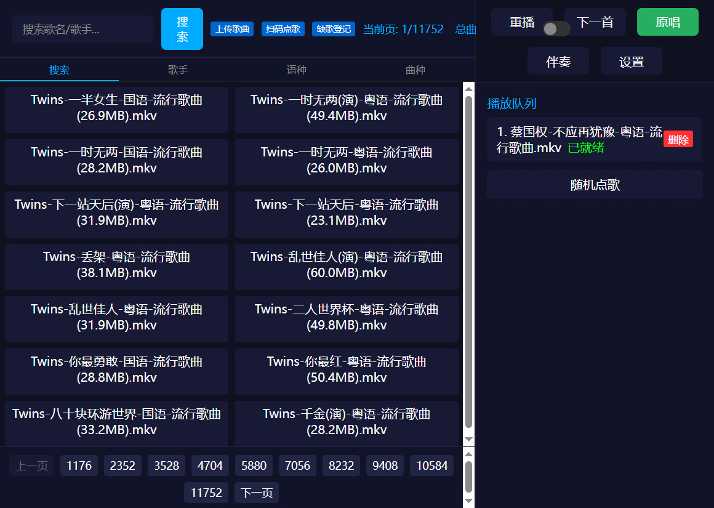

# Web KTV Server ／ Web KTV 点歌机

Language: [中文](#中文) | [English](#english)

---

## 中文

一个轻量级的局域网 KTV 双屏点歌系统。10MB 的程序，让整个局域网变成 KTV。

### 特性

#### 点歌方式
- 关键词搜索，16 万首曲库 10 毫秒出结果
- 歌名+歌手组合搜索，拼音首字母搜索
- 歌手分类浏览，按首字母快速定位
- 语种分类（国语/粤语/英语/日语/韩语...）
- 曲种分类（流行歌曲/经典老歌/摇滚/民谣...）
- 随机点歌，同名歌曲自动标注文件大小
- Everything 文件扩充搜索，自动读取 HTTP 端口/账号，支持本机全盘搜索直接点播

#### 播放
- 视频/音频自动识别，原唱/伴奏一键切换
- 内嵌歌词实时滚动，支持在线歌词搜索/手动匹配/偏移微调
- 音频可视化：歌词/波形/频谱条/频谱曲线 四种模式
- 曲库文件异常自动检测（无画面/无声音文件红色标注）
- **隔行(1080i)H.264 自动检测并去隔行转码**，彻底解决浏览器播放卡死
- **边写边播**：无可用曲目且队首进入转码时，实时流式播放分片 MP4，无需等待转码完成
- 自适应音量·前瞻限幅，自动平衡响度并压住瞬态破音

#### 手机遥控
- 扫码即用，无需安装 APP
- 搜索、点歌、切歌、重唱、音量、快进10秒……
- 可设密码，多人同时扫码队列共享

#### 省流模式
- 一键开启，视频实时转码低码率传输
- GPU 全流水线加速（解码+编码都在 GPU），1-2 秒出画面
- 动态流控，只缓冲 15 秒，切歌不浪费带宽

#### 系统自检
- 启动时自动检测 FFmpeg、FFprobe、GPU 加速、曲库目录
- 打开页面即显示系统状态总览，异常红色标注附解决方案

#### 其他
- 网页拖拽上传歌曲，上传后自动增量扫描，含内容审核
- 曲库缓存，二次启动秒级加载
- 缺歌登记，自动记录搜不到的关键词
- 支持 HEVC/H.265、WMA/APE/DSD 等自动转码/实时推流
- NVIDIA/AMD/Intel GPU 自动检测
- 32 位和 64 位双版本，兼容 Win7 SP1 ~ Win11

### 截图

<table>
<tr>
<td></td>
<td></td>
</tr>
<tr>
<td></td>
<td></td>
</tr>
</table>

### 快速开始

**1. 下载** 从 [Releases](https://github.com/ehfeo/Web-ktv-server/releases) 下载最新版本。

**2. 准备 FFmpeg** 下载 [ffmpeg.exe](https://www.gyan.dev/ffmpeg/builds/) 和 [ffprobe.exe](https://www.gyan.dev/ffmpeg/builds/)，放到程序同目录。

> 需要 GPU 加速转码请使用完整版 FFmpeg（含 NVENC/QSV/AMF 支持）。

**3. 运行** 双击 `ktv.exe`（64 位）或 `ktv-32bit.exe`（32 位）。

**4. 使用**
1. 在菜单中填入歌曲目录（支持多个盘符）
2. 浏览器打开显示的地址 → 点歌界面
3. 手机扫页面上的二维码 → 遥控器

### 系统要求

- **服务端**：Windows 7 SP1 及以上，32 位或 64 位
- **客户端**：任意现代浏览器（Chrome / Edge / Firefox / Safari）
- **网络**：局域网（服务端和客户端在同一网段）
- **依赖**：ffmpeg.exe + ffprobe.exe（放程序同目录）

### 编译

需要 Go 1.20.14（确保 Win7 SP1 兼容性）：

```powershell
# 一键编译 32 位和 64 位版本
.\build.ps1
```

编译产物输出到 `dist/` 目录。

### 技术栈

- Go 语言编写，单文件部署，前端全部内嵌
- Fragmented MP4 实时流媒体，FFmpeg 管道输出
- GPU 全流水线加速（CUDA 解码 + NVENC 编码），无 GPU 自动回退 CPU
- Web Audio API 实时可视化，预分配缓冲零 GC
- QR 中继服务器架构，支持跨网段扫码点歌
- 曲库缓存 + 增量扫描 + 预计算搜索索引

### License ／ 许可证

MIT

---

## English

A lightweight LAN KTV dual-screen song-selection system. A ~10 MB program turns your whole LAN into a KTV.

### Features

#### Song Selection
- Keyword search, 160k-song library returned in ~10 ms
- Title + artist combined search, pinyin initials search
- Artist browsing with quick A-Z navigation
- Language categories (Mandarin/Cantonese/English/Japanese/Korean...)
- Genre categories (Pop/Classics/Rock/Folk...)
- Random pick, duplicate titles auto-marked with file size
- Everything-file expanded search: reads HTTP port/credentials automatically, searches the whole drive and plays directly

#### Playback
- Auto video/audio detection, one-click backing/accompaniment switch
- Built-in real-time scrolling lyrics, online lyric search / manual match / offset fine-tune
- Audio visualization: lyrics / waveform / spectral bars / spectral curve
- Auto-detect broken library files (red badges for no-video/no-audio)
- **Auto-detect and deinterlace interlaced (1080i) H.264** — fixes browser playback freezes for good
- **Play-while-transcoding**: when no song is ready and the queue front has entered transcoding, a fragmented MP4 is streamed live without waiting for conversion
- Adaptive volume with look-ahead limiting, balancing loudness and capping transient clipping

#### Mobile Remote
- Scan QR to use — no app install
- Search, select, change song, replay, volume, seek +10s...
- Optional password, multi-device sharing one shared queue

#### Low-Bandwidth Mode
- One-click real-time low-bitrate video transcoding
- Full GPU pipeline (decode + encode on GPU), picture in 1-2 s
- Dynamic flow control, buffers only ~15 s, no wasted bandwidth on song change

#### Self-Check
- Auto-detects FFmpeg, FFprobe, GPU accel, library dirs at startup
- System status overview on page load; issues marked red with solutions

#### Others
- Drag-and-drop upload with auto incremental re-scan and content review
- Library cache, instant second startup
- Missing-song registration, records unsearchable keywords automatically
- HEVC/H.265, WMA/APE/DSD etc. auto-transcode / real-time streaming
- NVIDIA/AMD/Intel GPU auto-detection
- 32-bit & 64-bit builds, Windows 7 SP1 ~ Windows 11

### Screenshots

See the tables above (main UI, player window, mobile search, spectrum visualization).

### Quick Start

1. **Download** the latest release from [Releases](https://github.com/ehfeo/Web-ktv-server/releases).
2. **Get FFmpeg** — put [ffmpeg.exe](https://www.gyan.dev/ffmpeg/builds/) and [ffprobe.exe](https://www.gyan.dev/ffmpeg/builds/) next to the program.
   > Use the full FFmpeg build (NVENC/QSV/AMF) for GPU-accelerated transcoding.
3. **Run** — launch `ktv.exe` (64-bit) or `ktv-32bit.exe` (32-bit).
4. **Use** — enter your song directories in the menu, open the shown address, scan the QR for remote control.

### Requirements

- **Server**: Windows 7 SP1+, 32-bit or 64-bit
- **Clients**: any modern browser (Chrome / Edge / Firefox / Safari)
- **Network**: LAN (same subnet)
- **Deps**: ffmpeg.exe + ffprobe.exe (same folder)

### Build

Requires Go 1.20.14 (for Win7 SP1 compatibility):

```powershell
.\build.ps1      # builds 32-bit and 64-bit
```

Output goes to the `dist/` directory.

### Tech Stack

- Go, single-file deployment, fully embedded front-end
- Fragmented MP4 live streaming over FFmpeg pipe
- Full GPU pipeline (CUDA decode + NVENC encode), CPU fallback
- Web Audio API visualization with preallocated zero-GC buffers
- QR relay server supporting cross-subnet remote selection
- Library cache + incremental scan + precomputed search index

### License

MIT